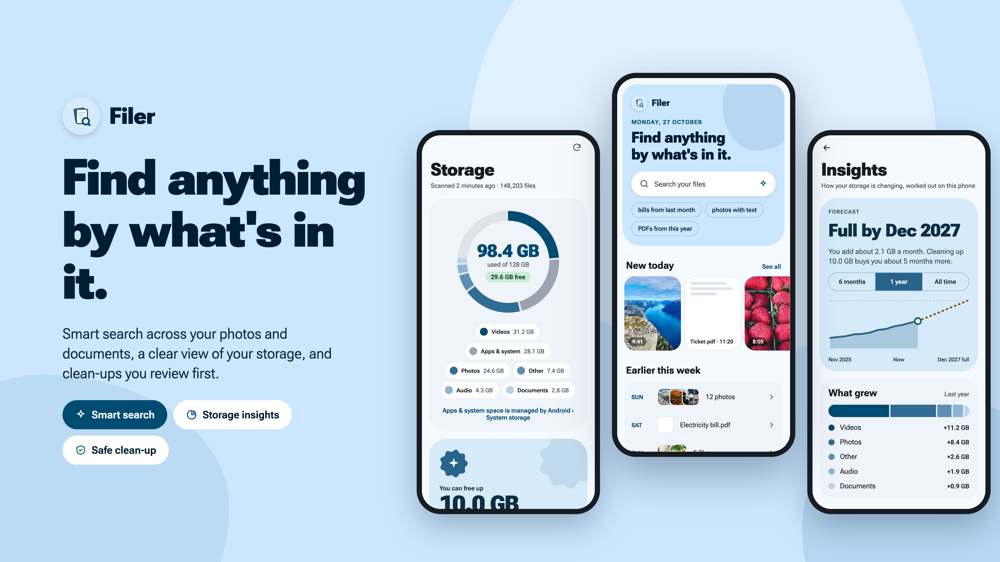

# Filer

**An offline Android file manager that finds files by what's in them.**

Filer browses your whole phone like a regular file manager, and adds *smart search*: type
"electricity bill from march", "photo of a whiteboard" or "pdf downloaded 2 days ago" and it finds
the file by meaning, not just by name. Everything runs on the phone. No account, no cloud, no
telemetry. Files never leave the device.

| | |
| --- | --- |
| Platform | Android 12+ (minSdk 31, targetSdk 35), arm64 / armv7 / x86_64 |
| Stack | Kotlin, Jetpack Compose (Material 3), Room + SQLite FTS4, WorkManager |
| Search model | [EmbeddingGemma 2](https://huggingface.co/litert-community/embeddinggemma-2-740m-litert-lm) (740M, LiteRT-LM via MediaPipe), 485 MB, optional download |
| Download | **[GitHub Releases](https://github.com/NavaneethVijay/filer/releases)** (free, sideloaded APK) |

## Features

- **File manager**: browse every volume (internal storage, SD card), categories (images, videos,
  audio, documents, downloads, APKs), recent files by day, list or grid, real previews (photos,
  video frames, PDF pages, album art, APK icons). Rename, new folder, move/copy with a clipboard
  bar, share, favourites. Pull down on Browse to pick up files other apps changed without telling
  Android.
- **Recycle bin** (restore or auto-purge after 30 days) and a **Locked folder** behind fingerprint
  or screen lock.
- **Smart search** (optional): pick folders, or the whole phone, to index. Photos, PDFs, text and
  code, `.docx` and `.odt` are searched by meaning, with keyword matching mixed in. Every other file
  is still found instantly by name.
- **Natural queries**: dates ("yesterday", "last week", "in march"), types ("pdfs"), apps and
  folders ("whatsapp", "screenshots"), size ("over 10 mb") and places ("photos from goa", from the
  photo's GPS with an offline place list). These work even without smart search.
- **Storage tab**: what uses your space, duplicates (pick which copies stay: smart pick, newest,
  oldest, or by folder), large and old files, chat-app media, junk, and a folder space map.
  **Insights tab**: a forecast of when the phone fills up, what grew, and what's worth a look. Nothing is suggested from
  `Android/`, hidden or backup folders.
- **AI plugins** (optional downloads, run only when you tap): read text in photos, transcribe
  recordings, suggest tags. See [AI plugins](#ai-plugins).
- Built-in viewers for photos, videos, PDFs, text and audio. Material You colours, light/dark.

## How it works

```
 Your folders ──► discovery ──► extract text ──► 200-word passages ──► EmbeddingGemma 2 ──► SQLite
 (or whole phone)  (new/changed   (PDF, docx,      (photos go to the     (on the phone's      vectors (float16)
                    files only)    text, photos)    model as images)      GPU/CPU)             + FTS4 keyword index

 Query ──► QueryParser (dates, types, places…) ──► embed query ──► cosine vs all vectors ──► rank
                                                                    + keyword coverage      results
```

1. **Indexing.** Filer finds new and changed files in the smart-search folders, extracts their
   text, splits it into passages and turns each passage (and each photo) into a 768-number vector
   with EmbeddingGemma 2. Vectors and a full-text index are stored in a local SQLite database. Big
   jobs wait for the charger and an idle phone, and slow down or pause when the phone gets warm.
2. **Searching.** The query is parsed for filters (dates, types, folders, size, places) and the
   remaining words are embedded with the same model. Every stored vector is compared with the
   query; results that clearly stand out from the rest, or that contain the query's words, are
   ranked together (hybrid meaning + keyword scoring).
3. **Privacy.** The model and plugins are downloaded only when you tap to turn them on. After that
   Filer needs no network. MediaPipe's built-in telemetry is stripped from the build.

More detail for contributors: [`AGENTS.md`](AGENTS.md) (architecture, conventions, backlog).

## AI plugins

Filer is a file manager first: the core app needs no model at all. Extra abilities come as
**plugins**, small on-device models you download separately from Settings › Search › AI plugins.

- **Optional and per file.** Nothing is downloaded until you tap Download, and a plugin runs only
  when you tap its action on a file (*Read text*, *Transcribe*, *Suggest tags*). Opening a file
  just shows it.
- **Independent of smart search.** Plugins work without the 485 MB search model. When smart search
  is on, their results (text read from a photo, a transcript) are also added to the index, so
  those files become searchable by what was read or said.
- **On the phone, one model at a time.** Plugins run on ONNX Runtime (CPU), take turns with the
  search model, and refuse to start when the phone is too hot. Each one checks the phone first
  (64-bit, enough memory, free space) and says clearly if it can't run.
- **Results are kept** in Filer's own database and follow the file when you rename, move, bin or
  restore it. Downloads are resumable and can be removed at any time.

| Plugin | What it does | Model | Download |
| --- | --- | --- | --- |
| **Text in photos** | *Read text* in photos, screenshots and scanned PDFs; copy or search it | [PP-OCRv6 small](https://huggingface.co/PaddlePaddle/PP-OCRv6_small_rec_onnx) (PaddlePaddle, Apache-2.0) | ~31 MB |
| ↳ Indian scripts | Extra readers for Devanagari (Hindi, Marathi…), Tamil and Telugu | PP-OCRv5 mobile | ~8 MB each, optional |
| **Audio & voice notes** | *Transcribe* recordings and voice notes, with timestamps and tap-to-play; language auto-detected or chosen | [Whisper tiny](https://huggingface.co/onnx-community/whisper-tiny), multilingual, int8 (OpenAI, MIT) | ~42 MB |

**Suggest tags** is built in rather than a download: it uses the smart-search model to match a
file against ~100 everyday labels (plus your own tags), and adds tags from where the file came from
(WhatsApp, screenshots) and where a photo was taken. Unclear names like `IMG_2041.jpg` also get a
suggested name from the date, document type and title. Tags are managed on the Tags screen and
searchable with `#tag`.

New plugins follow the same pattern: an `AiPlugin` entry with its model files and exact sizes, a
`DeviceCapability` check, and an engine that runs inside `EmbedderEngine.exclusive` (rules in
[`AGENTS.md`](AGENTS.md)).

## Install

### 1. Download the APK

Download the latest release from **[GitHub Releases](https://github.com/NavaneethVijay/filer/releases)**:

| File | Target Devices | Notes |
| :--- | :--- | :--- |
| **`Filer-*-arm64-v8a.apk`** | Modern 64-bit phones | **Recommended** — covers virtually all Android phones from the past 7+ years (Pixel, Samsung, OnePlus, Xiaomi…) |
| `Filer-*-armeabi-v7a.apk` | Older 32-bit phones | For legacy Android hardware |
| `Filer-*-x86_64.apk` | Emulators / PCs | For Android Studio emulators and Chromebooks |

### 2. Install on Android

1. **Download**: Open the **[Releases](https://github.com/NavaneethVijay/filer/releases)** page on your Android phone and download the `arm64-v8a` APK file.
2. **Allow installation**: Tap the downloaded file in your browser or Downloads folder. If prompted with *"For your security, your phone is not allowed to install unknown apps from this source"*, tap **Settings** and turn on **Allow from this source**.
3. **Install & Grant permission**: Tap **Install**. Open Filer and grant **All files access** (Manage External Storage) when prompted. This allows Filer to browse your files and index them locally.
4. *(Optional)* **Enable Smart Search**: On the home screen or in Settings, tap **Turn on** smart search to download the offline search model (EmbeddingGemma 2, 485 MB, Wi-Fi recommended), then choose which folders to index.

> [!TIP]
> **Updating**: Future releases install directly over existing versions without losing your downloaded models, settings, or search index. (Uninstalling the app will delete the model and index).

Alternatively, install from a computer using ADB:
```sh
adb install -r Filer-v1.0.0-arm64-v8a.apk
```

### Build from source

Needs JDK 17, the Android SDK (platform 35) and `adb`. The Gradle wrapper (8.7) is included.

```sh
git clone <this repo> && cd file-search
./gradlew :app:assembleRelease      # → app/build/outputs/apk/release/app-<abi>-release.apk
adb install -r app/build/outputs/apk/release/app-arm64-v8a-release.apk
```

- One APK per ABI (`arm64-v8a`, `armeabi-v7a`, `x86_64`, ~96 MB each).
- Release builds are signed when these are set in `~/.gradle/gradle.properties` (never commit them);
  without them the release APK is unsigned:

  ```properties
  FILER_RELEASE_STORE_FILE=/path/to/filer-release.jks
  FILER_RELEASE_STORE_PASSWORD=…
  FILER_RELEASE_KEY_ALIAS=…
  FILER_RELEASE_KEY_PASSWORD=…
  ```

- `./gradlew :app:installDebug` for a quick debug build (much slower UI; don't judge performance
  on it). Unit tests: `./gradlew :app:testDebugUnitTest`.
- `app/libs/tasks-core-patched.aar` is a patched MediaPipe tasks-core (telemetry removed); keep it.
- Build output shows `Module was compiled with an incompatible version of Kotlin` lines from
  dependencies; they are harmless. Look for `BUILD FAILED` for real errors.

## Index on a Mac (Developer mode)

Indexing a large folder or the whole phone takes a while on the phone alone. With the
**[Mac embedder server](tools/mac_embedder/README.md)** (`tools/mac_embedder`), a USB-connected
Apple Silicon Mac runs the same EmbeddingGemma 2 model file on its GPU and does the heavy
indexing work, many times faster and without heating the phone. Searches still run on the phone.

```sh
cd tools/mac_embedder
./run.sh        # downloads the model once, starts http://127.0.0.1:9379, sets up adb reverse
```

Then in Filer: Settings › Privacy & about › tap the version 7 times › Settings › Developer ›
**Index with Mac**. Traffic stays on the USB cable (`adb reverse`, `127.0.0.1` only). Setup,
options and troubleshooting are in the [Mac embedder README](tools/mac_embedder/README.md).

## Repository layout

| Path | What |
| --- | --- |
| `app/` | The Android app (`com.navaneeth.filer`) |
| `tools/mac_embedder/` | Python (uv) server for Developer-mode indexing on a Mac |
| `tools/build_places.py` | Builds the offline place list `app/src/main/assets/places.tsv` from GeoNames |
| `AGENTS.md` | Architecture, conventions, backlog and status (for contributors and coding agents) |

## Credits

Models: EmbeddingGemma 2 (Google), PP-OCR (PaddlePaddle), Whisper (OpenAI). Place names from
[GeoNames](https://www.geonames.org/) (CC BY 4.0).
